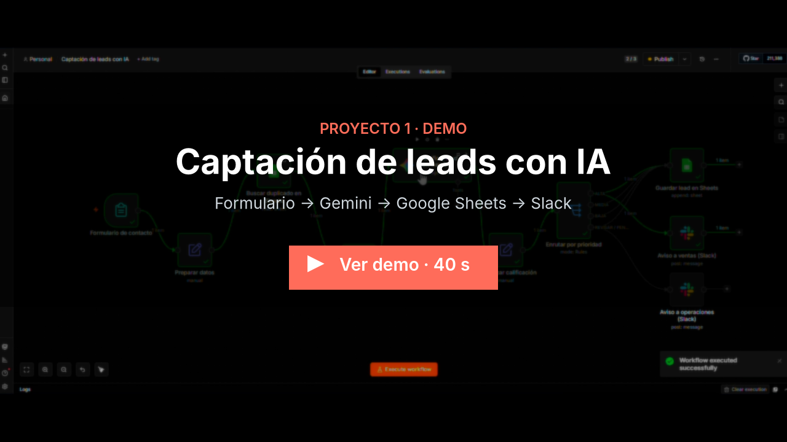
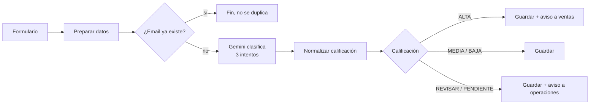

# Proyecto 1 · Captación y clasificación de leads con IA

[← Volver al inicio](./README.md) · [JSON](./workflows/01-captacion-leads.json) · [Vídeo](./media/proyecto1-demo.mp4)

*Ejecución real en mi n8n local con un lead de prueba (40 s, sin audio).*

## El escenario

Una empresa pequeña recibe peticiones de contacto por un formulario web. Alguien tiene que leerlas una a una, decidir cuáles son urgentes y apuntarlas en una hoja. Si un cliente escribe dos veces, aparece dos veces. Si nadie mira el formulario un viernes por la tarde, el lead caliente espera al lunes.

Quería que eso pasara solo y que, cuando algo fallase, se enterase alguien.

## Qué hace

1. **Formulario:** el cliente deja su nombre, su email y en qué necesita ayuda. Los tres campos son obligatorios.
2. **Preparar datos:** quito espacios y paso el email a minúsculas. Parece un detalle, pero sin esto `Ana@Mail.com` y `ana@mail.com ` cuentan como dos clientes distintos.
3. **Duplicados:** busco el email en la hoja. Si ya existe, el flujo se para ahí. Lo hago **antes** de llamar a la IA para no pagar por clasificar a alguien que ya tengo.
4. **Clasificación con Gemini:** la IA lee el mensaje y responde con una palabra: `ALTA`, `MEDIA` o `BAJA`. El texto del cliente va delimitado y el prompt deja claro que es contenido, no instrucciones, para que nadie pueda «darle órdenes» a la IA desde el formulario.
5. **Normalizar la calificación:** un modelo de lenguaje no siempre contesta exactamente lo que le pides («Alta.», «ALTA» con un salto de línea…). Normalizo la respuesta y, si no es una de las tres palabras, el lead se marca como `REVISAR`.
6. **Guardar y avisar:** todos los leads acaban en Google Sheets. Los de prioridad `ALTA` además generan un aviso en el canal comercial de Slack. Los que la IA no ha podido clasificar avisan a operaciones.

## Qué pasa cuando algo falla

| Situación | Qué hace el flujo |
|---|---|
| El mismo cliente escribe otra vez, aunque cambie mayúsculas o deje espacios | Se detecta como duplicado y no se repite |
| Gemini da error o límite de peticiones (429) | Hasta 3 intentos, con 5 segundos entre uno y otro. Si sigue fallando, el lead **no se pierde**: se guarda como `PENDIENTE` y avisa a operaciones |
| Gemini responde algo que no es ALTA, MEDIA o BAJA | Se guarda como `REVISAR` y avisa a operaciones |
| Falla cualquier otra cosa (p. ej. caduca el acceso a Google Sheets) | El workflow global de alertas manda a Slack el nodo, el motivo y el enlace a la ejecución |

## Qué cambié al revisarlo

La primera versión funcionaba en el caso feliz, pero tenía huecos que solo vi al probarla en serio:

- **Llamaba a Gemini antes de comprobar duplicados**, así que pagaba por clasificar leads repetidos. Ahora el orden es el contrario.
- **Si Gemini respondía «Alta» o «ALTA\n», ninguna regla coincidía y el lead no se guardaba ni avisaba.** El Switch no tenía salida para lo inesperado. Ahora la respuesta se normaliza y hay una salida de respaldo.
- **Un error 429 de Gemini cortaba el flujo y ese lead se perdía.** Me pasó de verdad. Ahora hay reintentos y, si fallan, el lead se guarda como `PENDIENTE`.
- **El Switch mandaba las tres salidas al mismo sitio**, así que no servía para nada. Ahora cada salida hace algo distinto: avisa a ventas, solo guarda, o avisa a operaciones.
- **El formulario aceptaba campos vacíos** y llegaban filas en blanco a la hoja.

## Lo que mejoraría con un cliente real

- **Pasar de Google Sheets a una base de datos** o al propio CRM. Sheets va bien para empezar, pero buscar duplicados ahí es lento cuando hay miles de filas.
- **Reprocesar los `PENDIENTE` solos**, con un flujo programado que los vuelva a mandar a Gemini cada hora.
- **Guardar el motivo de la clasificación**, no solo la etiqueta, para que el comercial sepa por qué un lead es ALTA.

## Capturas

**El workflow en n8n**, con los nombres de cada paso:

**El resultado en Google Sheets:** cada lead registrado con la fecha y la calificación que ha asignado Gemini.

