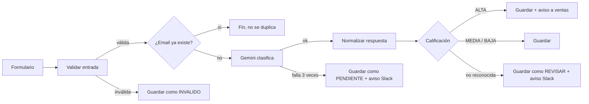
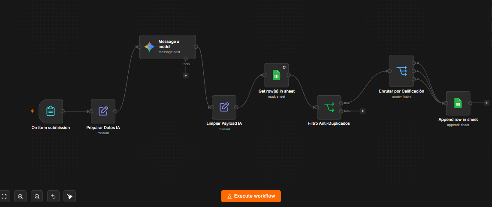
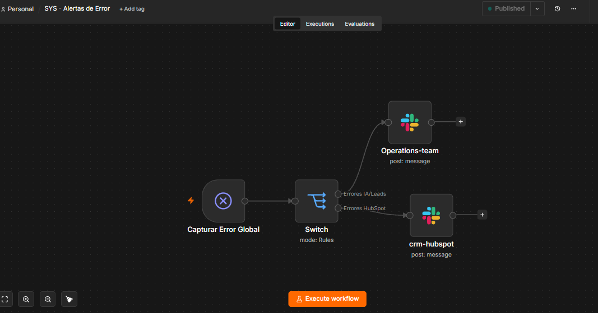
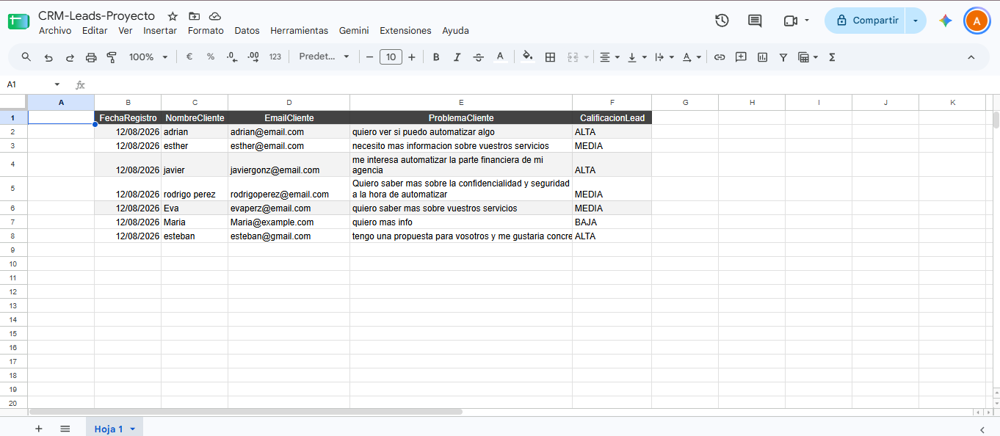
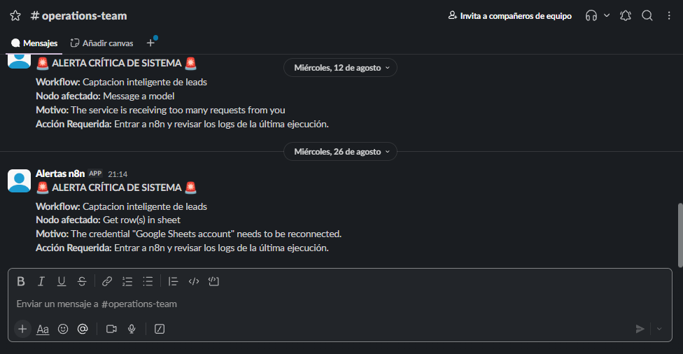

# Proyecto 1 · Captación y clasificación de leads con IA

[← Volver al inicio](./README.md)

## El escenario

Una empresa pequeña recibe peticiones de contacto por un formulario web. Alguien tiene que leerlas una a una, decidir cuáles son urgentes y apuntarlas en una hoja. Si un cliente escribe dos veces, aparece dos veces. Si nadie mira el formulario un viernes por la tarde, el lead caliente espera al lunes.

Quería que eso pasara solo y que, cuando algo fallase, se enterase alguien.

## Qué hace

1. El cliente rellena un formulario con nombre, email y en qué necesita ayuda.
2. **Validación:** limpio espacios, paso el email a minúsculas y compruebo que tiene formato válido. Si no lo tiene, se guarda igualmente marcado como `INVALIDO` para revisarlo, pero no gasta una llamada a la IA.
3. **Duplicados:** busco el email en la hoja. Si ya existe, el flujo para ahí. Lo hago **antes** de llamar a Gemini para no pagar por clasificar a alguien que ya tengo.
4. **Clasificación:** Gemini lee el mensaje y responde con una sola palabra: `ALTA`, `MEDIA` o `BAJA`. El texto del cliente va delimitado y el prompt aclara que es contenido, no instrucciones, para que nadie pueda "darle órdenes" a la IA desde el formulario.
5. **Normalización de la respuesta:** un modelo de lenguaje no siempre responde exactamente lo que pides. Paso la respuesta a mayúsculas y busco una de las tres palabras. Si no encuentro ninguna, el lead se guarda como `REVISAR` y aviso por Slack.
6. **Guardado y aviso:** todo lead acaba en Google Sheets. Los de prioridad `ALTA` además generan un mensaje en el canal comercial de Slack con el nombre, el email y el problema.

## Qué pasa cuando algo falla

| Situación | Qué hace el flujo |
|---|---|
| Email mal escrito o campos vacíos | Fila con `INVALIDO`, sin gastar IA |
| El mismo cliente escribe otra vez (aunque cambie mayúsculas o deje un espacio) | Se detecta como duplicado y no se repite |
| Gemini da error o límite de peticiones (429) | Hasta 3 intentos, con 5 segundos entre uno y otro. Si sigue fallando, el lead se guarda como `PENDIENTE` y llega un aviso a Slack |
| Gemini responde algo raro | Fila con `REVISAR` y aviso a Slack |
| Falla cualquier otra cosa (p. ej. caduca el acceso a Google Sheets) | El workflow de alertas global manda a Slack el nodo, el motivo y el enlace a la ejecución |

## Por qué hice una v2

La primera versión funcionaba en el caso feliz, pero tenía huecos que solo vi al probarla en serio:

- Llamaba a Gemini **antes** de comprobar duplicados, así que pagaba por clasificar leads repetidos.
- Si Gemini respondía `"ALTA\n"` o `"Alta"`, ninguna regla coincidía y el lead **no se guardaba ni avisaba**.
- Un error 429 de Gemini cortaba el flujo y ese lead se perdía.
- El formulario aceptaba campos vacíos, así que llegaban filas en blanco.

La v2 corrige las cuatro cosas. La v1 está desactivada en mi n8n como referencia.

## Lo que mejoraría con un cliente real

- **Pasar de Google Sheets a una base de datos** (o al propio CRM). Sheets va bien para empezar, pero buscar duplicados ahí es lento cuando hay miles de filas.
- **Reprocesar los `PENDIENTE` solos**: un flujo programado que los vuelva a mandar a Gemini cada hora.
- **Guardar el motivo de la clasificación**, no solo la etiqueta, para que el comercial sepa por qué es ALTA.

## Capturas

Capturas de la primera versión del flujo:

