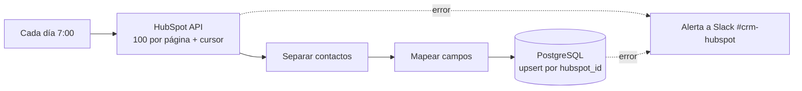
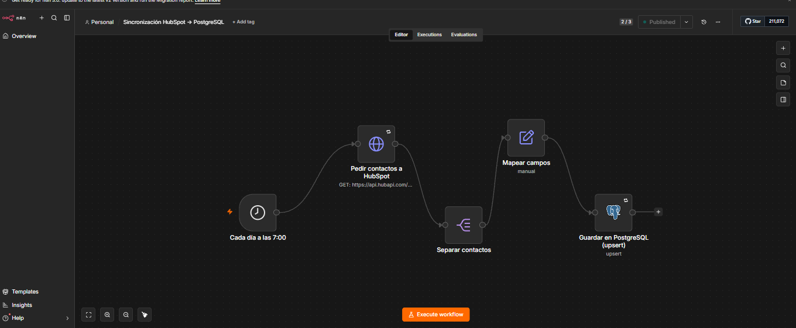
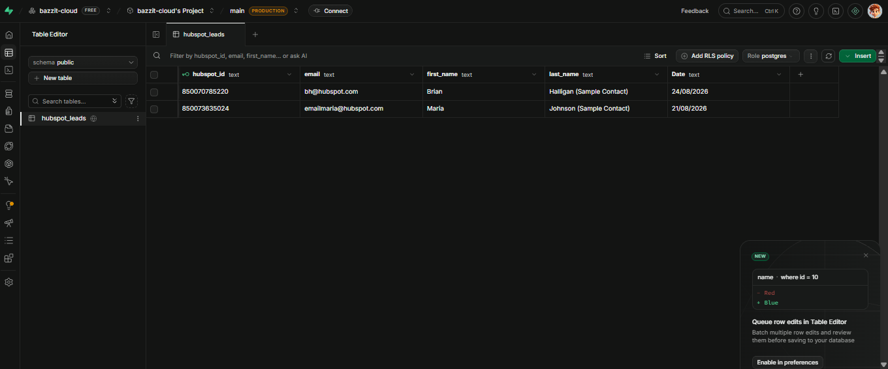

# Proyecto 2 · Sincronizar contactos de HubSpot con PostgreSQL

[← Volver al inicio](./README.md)

## El escenario

Los contactos viven en HubSpot, pero operaciones quiere tenerlos en una base de datos propia para cruzarlos con facturación o sacar informes sin depender de exportar CSVs a mano. Exportar a mano cada semana acaba en datos desfasados y en duplicados.

## Qué hace

1. **Cada día a las 7:00** se lanza solo.
2. **Pide los contactos a la API de HubSpot** (`/crm/v3/objects/contacts`), solo con los campos que necesito: email, nombre, apellido y fecha de última modificación.
3. **Pagina:** HubSpot devuelve como máximo 100 contactos por llamada y un cursor (`paging.next.after`) para pedir los siguientes. El nodo HTTP sigue pidiendo páginas hasta que no hay más, con un tope de 50 páginas y una pausa corta entre llamadas para no chocar con el límite de la API.
4. **Separa y renombra campos** al formato de mi tabla (`hubspot_id`, `email`, `first_name`, `last_name`, fecha).
5. **Upsert en PostgreSQL** (alojado en Supabase) usando `hubspot_id` como clave: si el contacto ya existe se actualiza, si no se crea. Así el flujo se puede relanzar sin crear duplicados, y un reintento nunca ensucia la tabla.

## Qué pasa cuando algo falla

- **Fallo puntual de la API de HubSpot o de la base de datos:** los dos nodos reintentan solos, con 5 segundos entre intentos.
- **Falla de verdad:** el workflow global de alertas manda un mensaje al canal `#crm-hubspot` con el nodo que ha fallado, el motivo y el enlace a la ejecución. Lo probé provocando un error real: la alerta llegó a Slack en un par de segundos.

Escogí un canal propio para estos errores para que el equipo comercial no reciba ruido técnico que no le toca.

## Decisiones

- **Polling diario en vez de webhooks de HubSpot.** Para un informe diario no hace falta tiempo real, y así controlo cuántas llamadas hago a la API.
- **Pedir solo las propiedades necesarias.** Menos datos por llamada y menos sorpresas si alguien añade campos en HubSpot.

## Lo que mejoraría

- **Sincronización incremental:** en vez de traer todos los contactos cada día, traer solo los modificados desde la última ejecución (filtrando por `lastmodifieddate` con la API de búsqueda).
- **Guardar la fecha como fecha** (`timestamp`) y no como texto `dd/MM/yyyy`, para poder ordenar y filtrar en SQL.
- **Detectar contactos borrados** en HubSpot, que ahora mismo se quedarían en la tabla.

## Capturas

**El workflow en n8n:**

**El resultado en la base de datos** (PostgreSQL en Supabase): los contactos de HubSpot guardados en la tabla `hubspot_leads`.

