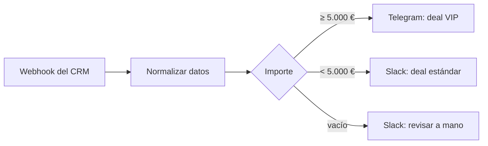
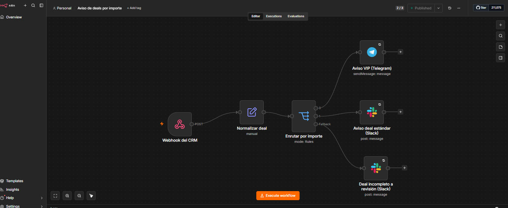
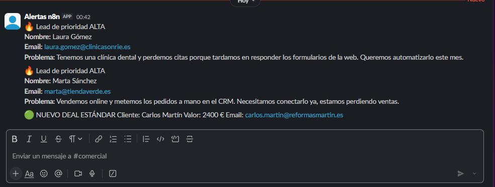
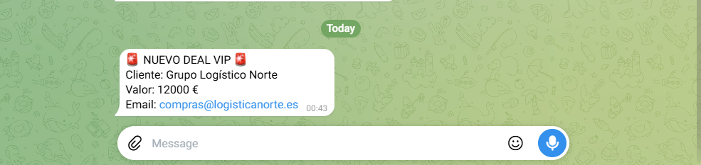

# Proyecto 3 · Avisar de cada deal en el canal adecuado

[← Volver al inicio](./README.md)

## El escenario

Cuando entra un deal en el CRM, ventas quiere enterarse al momento. Pero no todos los deals pesan lo mismo: uno de 8.000 € merece un aviso al móvil, uno de 800 € basta con verlo en Slack. Y a veces el CRM manda deals a medias, sin importe, que no deberían colarse como si nada.

## Qué hace

1. **Recibe el deal por webhook** (en formato JSON, como lo enviaría un CRM).
2. **Normaliza los datos:** saca el ID, el nombre, el email y el importe, y convierte el importe a número. Así `"8000"` en texto se trata igual que `8000`.
3. **Decide el canal:**
   - **5.000 € o más** → mensaje por Telegram ("deal VIP").
   - **Menos de 5.000 €** → mensaje en el canal comercial de Slack.
   - **Sin importe** → aviso en un canal de revisión: "falta el valor económico, revisadlo en el CRM", con el ID del deal y el cliente.

La clave está en el tercer camino. Un deal sin importe no es un error del sistema, es un dato incompleto. No quiero que el flujo se pare, ni que el deal se pierda, ni que se cuele como deal estándar con "0 €". Lo aparto y aviso.

## El fallo que encontré

Al probarlo enviando deals reales al webhook, **todos acababan en el canal de revisión**, incluso uno de 1.200 € con todos sus datos.

El motivo: cuando n8n recibe una petición en un webhook, el contenido no llega en la raíz, llega dentro de `body`. Mi nodo de normalización leía `$json.deal.amount`, cuando el dato real estaba en `$json.body.deal.amount`. En el editor no lo vi porque probaba con datos fijados a mano, que no llevaban ese `body`.

Lo corregí y lo volví a probar con tres casos: 1.200 € (llegó a Slack), 8.000 € (llegó a Telegram) y sin importe (llegó a revisión con el ID y el nombre del cliente).

Lo que me llevo: **probar el flujo como lo va a usar el sistema real**, no solo con datos de ejemplo en el editor.

## Si algo falla

Este flujo también está conectado al workflow global de alertas. Si, por ejemplo, Telegram o Slack no responden, después de 3 reintentos llega un aviso a Slack con el error y el enlace a la ejecución.

## Lo que mejoraría

- **Sacar el umbral de 5.000 € del flujo** a una variable o una tabla de configuración, para que ventas pueda cambiarlo sin tocar n8n.
- **Validar el origen del webhook** con una cabecera secreta, para que nadie de fuera pueda mandar deals falsos.
- **Agrupar los deals estándar** en un resumen cada hora si el volumen sube, para no llenar Slack.

## Capturas

