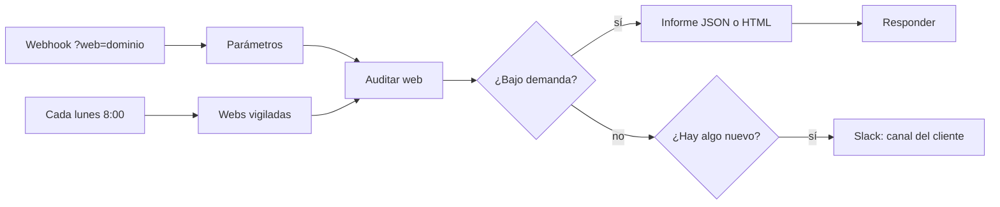
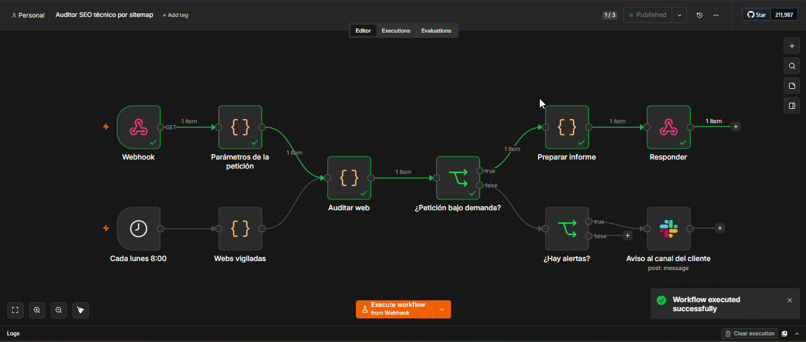
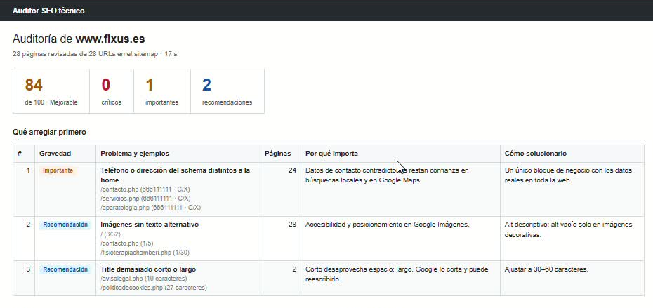
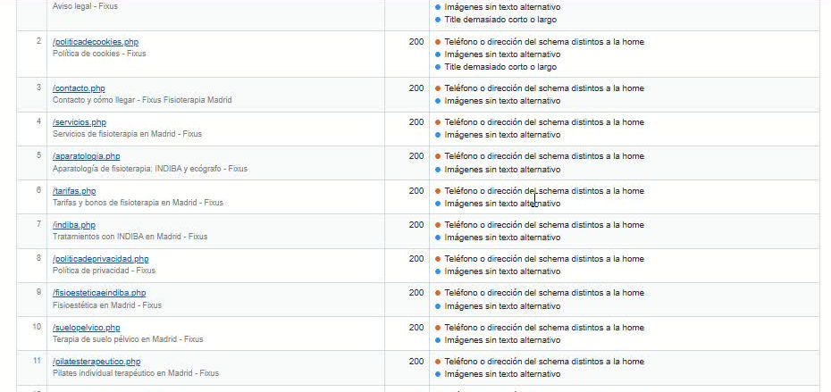

# Proyecto 4 · Auditor SEO técnico por sitemap

[← Volver al inicio](./README.md)

https://github.com/user-attachments/assets/3e86041c-9d4a-472d-b70e-939cdb691550

## El escenario

Revisar el SEO técnico de una web a mano, página por página, es lento y se escapan cosas. Y los fallos que más daño hacen casi nunca se ven navegando: un `noindex` olvidado, un canonical que apunta a otra página o unos datos estructurados que le dicen a Google un teléfono que no es.

Quería dos cosas:

1. **Bajo demanda:** pasar un dominio y tener en segundos qué falla, por qué importa y cómo arreglarlo.
2. **Vigilancia:** que cada semana se revisen varias webs solas y que solo me avise si aparece algo nuevo.

## Qué hace



1. **Encuentra el sitemap solo.** Mira primero el `robots.txt` y luego las rutas típicas (`/sitemap.xml`, `/sitemap_index.xml`, `/wp-sitemap.xml`). Si es un índice de sitemaps, como en Shopify o WordPress, entra en cada uno.
2. **Revisa cada URL.** Comprueba estado HTTP, redirecciones, `noindex`, title, meta description, H1, canonical, imágenes sin alt y datos estructurados. Además mira `robots.txt` (si bloquea el sitio o a los buscadores de IA) y si existe `llms.txt`.
3. **Prioriza.** Cada problema sale como **crítico**, **importante** o **recomendación**, con cuántas páginas afecta, ejemplos, por qué importa y cómo se soluciona.
4. **Pone una nota de 0 a 100.** Cada tipo de problema resta según su gravedad y el porcentaje de páginas afectadas.
5. **Devuelve el informe** en JSON (para conectarlo con otras herramientas) o en HTML (para leerlo o mandarlo).
6. **Vigila.** Cada lunes revisa la lista de webs, compara con la semana anterior y avisa en el canal de Slack de cada cliente solo si aparece un problema nuevo, empeora uno crítico o la nota baja 5 puntos o más.

Uso bajo demanda:

```
/webhook/auditor-seo?web=dominio.com&formato=html
```

Opcionales: `&max=100` (páginas a revisar, hasta 300) y `&sitemap=URL` si el sitemap está en una ruta rara.

## Lo que encontró en la primera prueba

Lo probé con la web de una clínica de Madrid. A simple vista estaba bien trabajada: titles y metas únicos, un H1 por página, FAQ marcadas con schema e incluso un `llms.txt`.

Pero **24 de sus 28 páginas declaraban en los datos estructurados un teléfono y una dirección de plantilla** (`666 11 11 11`, `C/X`), distintos de los reales que aparecen en la home. Para un negocio que depende de búsquedas locales, es de lo primero que hay que arreglar. Lo detecta una regla que compara el teléfono y la dirección del schema de cada página con los de la home.

## Decisiones que tomé

- **Un solo nodo de código para el análisis.** Necesitaba descargar varias páginas a la vez (4 en paralelo), con un tiempo máximo por petición, reintentos y un límite total por web. Con nodos sueltos eso no se controla bien y el flujo se llenaba de nodos. Así queda en 10.
- **Que no se rompa con webs raras.** Si la web no responde, devuelve «La web no responde» con nota 0. Las URLs con error, los timeouts y el HTML cortado salen como problemas, y un sitemap inválido no detiene la auditoría: revisa al menos la home.
- **Protección frente a webs enormes.** Máximo de 300 URLs, 15 segundos por página y 2,5 minutos por web. Si la web es más grande, revisa una muestra equilibrada de cada sitemap y lo indica en el informe.
- **Avisar solo de lo nuevo.** Un aviso cada lunes con los mismos 30 problemas acaba ignorándose. Por eso guarda la revisión anterior de cada web y solo avisa cuando algo cambia.

## Límites (para ser claro)

- **Lee el HTML que entrega el servidor.** En webs hechas solo con JavaScript (React, Vue sin renderizado en servidor) no vería el contenido; habría que renderizarlas.
- **No sustituye a Screaming Frog, Semrush o Ahrefs**, que miden mucho más (velocidad, enlaces rotos, enlazado interno...). Lo que aporta es lo que esas herramientas no hacen solas: reglas a medida, como la del NAP, y avisos automáticos a cada cliente.
- **La lista de webs vigiladas está en el propio flujo.** El siguiente paso natural es leerla de un Google Sheet.

## Lo que mejoraría

- Leer la lista de clientes desde Google Sheets.
- Crear una tarea en ClickUp o Asana por cada problema crítico nuevo.
- Añadir datos de rendimiento con la API de PageSpeed Insights.

## Capturas

**El workflow en n8n, tras una ejecución:**



**El informe: nota, recuento por gravedad y qué arreglar primero:**



**Las páginas revisadas, con sus problemas:**



El JSON del workflow está en [`workflows/05-auditor-seo.json`](./workflows/05-auditor-seo.json).
