# Anass Bassit · Automatización de marketing y ventas

Automatizo procesos de marketing, ventas y SEO para que ningún lead ni dato se pierda por el camino y para que el equipo se entere al momento cuando algo falla.

*In English: I automate marketing, sales and SEO processes so no lead or data point gets lost, and the team finds out immediately when something breaks. Below are four n8n projects — AI-based lead scoring, a HubSpot → PostgreSQL sync, deal routing by value, and a technical SEO auditor — each with the real production bugs I found and how I fixed them. Currently looking for automation / integrations / RevOps-Marketing Ops roles in Madrid.*

**Auditor SEO técnico: le paso un dominio y me dice qué falla, por qué importa y cómo arreglarlo (30 s, sin audio):**

https://github.com/user-attachments/assets/3e86041c-9d4a-472d-b70e-939cdb691550

## Qué resuelvo

- **Leads que se responden tarde.** Cada lead entra clasificado por prioridad y los urgentes llegan a ventas al momento.
- **Datos del CRM dispersos o duplicados.** Los contactos se sincronizan solos con una base de datos propia, sin exportar a mano.
- **Avisos que llegan a quien no toca.** Cada deal va al canal que le corresponde según su importe, y los incompletos van a revisión.
- **Errores de SEO técnico que no se ven navegando.** Cada web se revisa página a página, los problemas salen priorizados y, si aparece uno nuevo, avisa al momento.
- **Fallos que nadie detecta.** Si una automatización falla, el equipo recibe qué ha pasado y el enlace para arreglarlo.

## Sobre mí

Vengo del marketing digital (dos años como Responsable SEO y experiencia comercial B2B), así que parto del problema de negocio y no de la herramienta. Construyo las automatizaciones con n8n, APIs y algo de JavaScript.

Este repositorio recoge cuatro proyectos que he montado en mi propio n8n (Docker, en local). No son encargos de clientes: son escenarios realistas que me sirven para practicar con integraciones de verdad (Google Sheets, Gemini, HubSpot, PostgreSQL, Slack y Telegram) y, sobre todo, para aprender a que no se rompan en silencio. El cuarto junta mis dos mundos: SEO técnico y automatización.

## Los proyectos en 30 segundos

| | Qué resuelve | Herramientas |
|---|---|---|
| [**1. Captación de leads con IA**](./Proyecto_1_Captacion_Leads.md) | Alguien rellena un formulario. El flujo limpia los datos, descarta duplicados, le pide a Gemini que puntúe el lead (ALTA / MEDIA / BAJA), lo guarda y avisa a ventas si es urgente. | Form de n8n, Gemini, Google Sheets, Slack |
| [**2. HubSpot → PostgreSQL**](./Proyecto_2_HubSpot_Postgres.md) | Copia cada día los contactos de HubSpot a una base de datos propia, sin duplicados, para poder cruzarlos con otros datos. | API de HubSpot, PostgreSQL (Supabase), Slack |
| [**3. Aviso de deals por importe**](./Proyecto_3_Routing_Alertas.md) | Recibe deals por webhook. Si superan 5.000 € avisa por Telegram; si no, por Slack. Si falta el importe, lo manda a revisión en vez de perderlo. | Webhook, Slack, Telegram |
| [**4. Auditor SEO técnico**](./Proyecto_4_Auditor_SEO.md) | Le paso un dominio y revisa cada URL del sitemap: estado HTTP, noindex, title, meta, H1, canonical, alt y schema. Prioriza en críticos, importantes y recomendaciones, y cada lunes vigila varias webs y avisa por Slack solo si hay algo nuevo. | Webhook, JavaScript, Slack |

Los JSON de los cinco workflows están en [`/workflows`](./workflows), sin datos privados, para importarlos en cualquier n8n. Cada proyecto incluye capturas del flujo ejecutándose y de su resultado (Sheets, Supabase, Slack y Telegram), y el primero y el cuarto tienen además un vídeo de la ejecución completa.

## Capturas

**1. Captación de leads con IA** — el flujo y el resultado en Sheets

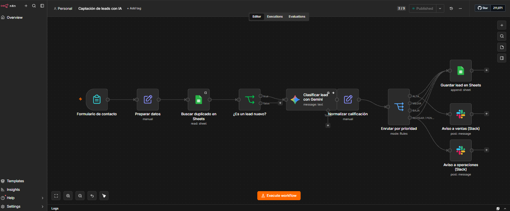
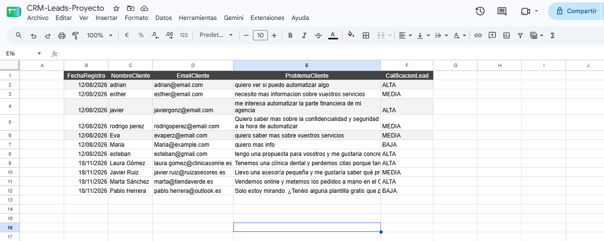

**2. HubSpot → PostgreSQL** — el flujo y los contactos ya sincronizados en Supabase

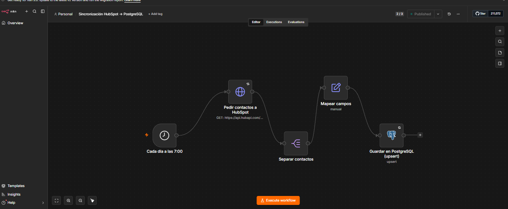
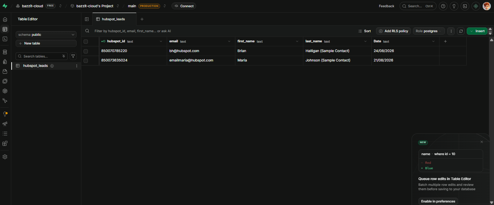

**3. Aviso de deals por importe** — el flujo y los avisos en Slack y Telegram

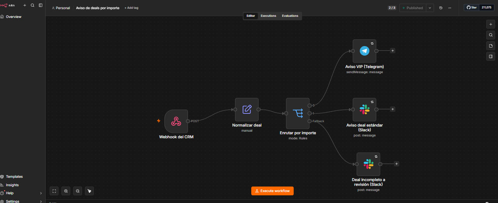
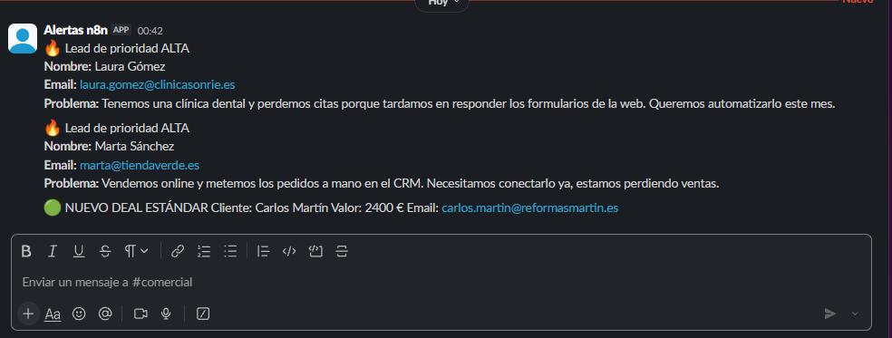
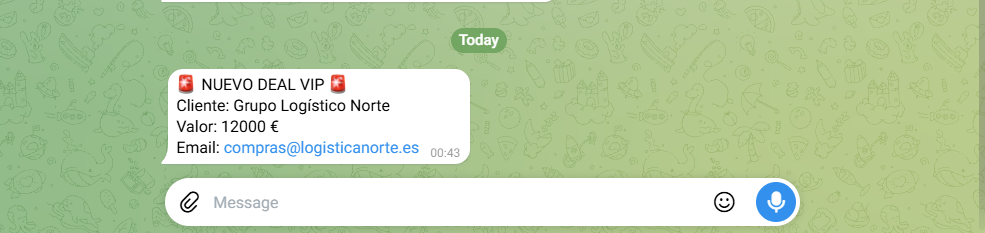

**4. Auditor SEO técnico** — el flujo y el informe generado, con los problemas priorizados

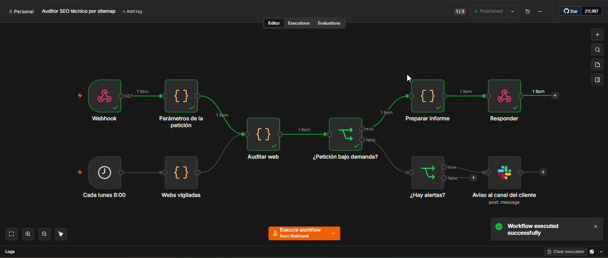
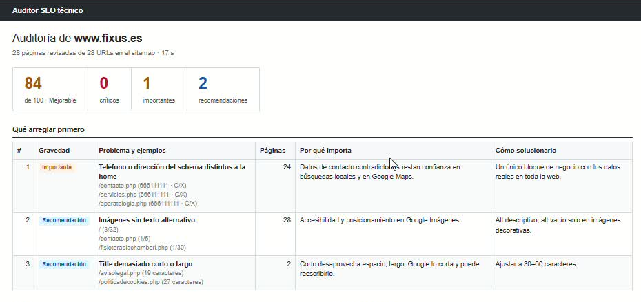
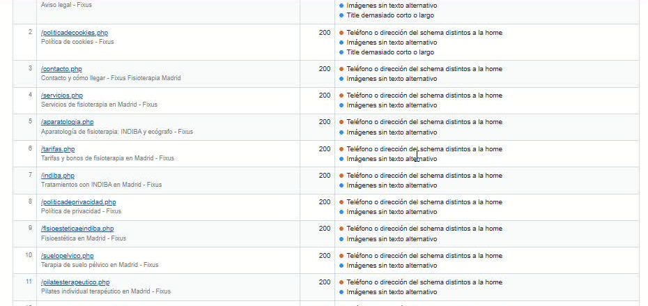

Todos comparten un **workflow de alertas**: si cualquiera falla, llega un mensaje a Slack con el workflow, el nodo que ha fallado, el motivo y un enlace directo a la ejecución.

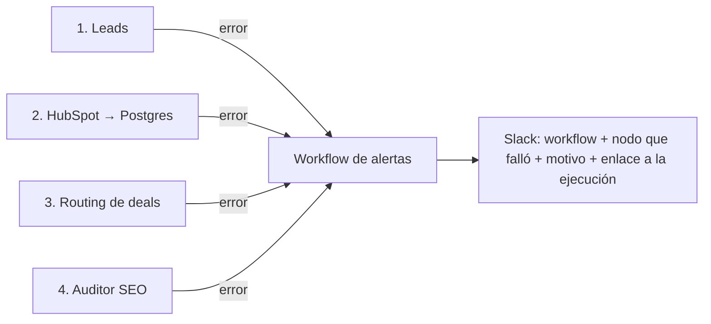

## Cómo trabajo

- **Primero que no se pierda nada, luego que sea bonito.** Cada camino raro (email inválido, IA caída, dato vacío) acaba en algún sitio visible: una fila marcada en la hoja o un aviso en Slack.
- **Pocos nodos y que cada uno tenga motivo.** Si un nodo no cambia el resultado, sobra.
- **Lo pruebo con datos reales, no solo en el editor.** Varios de los fallos que cuento abajo solo aparecían en producción.

## Lo que me encontré al revisar los flujos (y cómo lo arreglé)

Revisé los tres primeros proyectos de arriba abajo, lanzándolos como si fueran producción. Esto es lo que encontré:

- **El flujo de deals marcaba todos los deals como "error de datos".** En el editor funcionaba porque probaba con datos fijados, pero un webhook real mete el contenido dentro de `body`. El nodo de normalización leía `$json.deal` en vez de `$json.body.deal`, así que todo llegaba vacío. Ahora lee el deal en los dos casos, y lo comprobé con un deal estándar, uno VIP y uno sin importe.
- **Las alertas de error dependían del nombre del workflow.** Bastaba con renombrar un flujo para que sus errores dejaran de avisar, y los flujos que no estaban en la lista no avisaban nunca. Ahora se enruta por ID y hay una salida "general" para el resto.
- **La sincronización con HubSpot apuntaba a un endpoint que no existe** y pedía solo 2 contactos, una vez al mes. Ahora llama a `/crm/v3/objects/contacts`, pagina de 100 en 100 con el cursor `after` y se ejecuta a diario.
- **El clasificador de leads podía perder un lead sin avisar.** Si Gemini devolvía algo distinto de ALTA, MEDIA o BAJA (o fallaba por límite de peticiones), el lead no se guardaba. Ahora la respuesta se normaliza, hay reintentos y, si aun así falla, el lead se guarda como PENDIENTE y avisa. Además, los duplicados se comprueban antes de llamar a la IA, no después.
- **La conexión con Google Sheets caducaba.** Suele pasar cuando la app OAuth de Google está en modo "Testing", donde el permiso solo dura unos días. La alerta de errores lo detectó, que es justo para lo que está.

## Stack

n8n (self-hosted en Docker) · SEO técnico (sitemaps, robots.txt, schema) · JavaScript dentro de n8n · APIs REST, webhooks y JSON · HubSpot · PostgreSQL (Supabase) · Google Sheets · Gemini · Slack · Telegram · Git

## Contacto

- LinkedIn: [linkedin.com/in/anass-bassit-2b916326b](https://www.linkedin.com/in/anass-bassit-2b916326b)
- Busco puestos de automatización, integraciones u operaciones (Marketing Ops / Sales Ops / RevOps) en Madrid. Disponible para trabajo presencial, híbrido o remoto, con incorporación inmediata.
